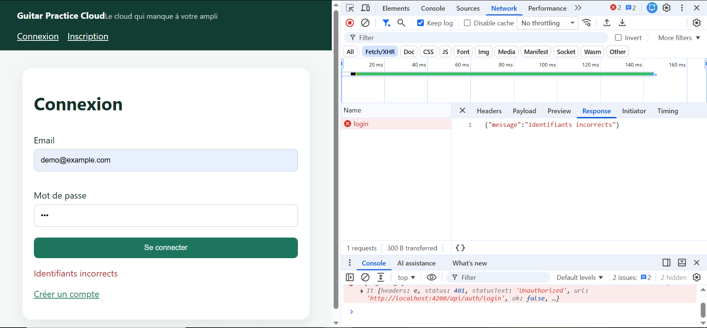
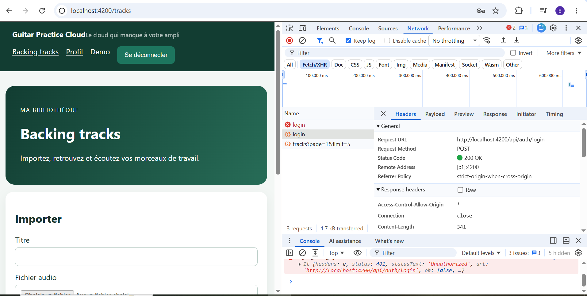
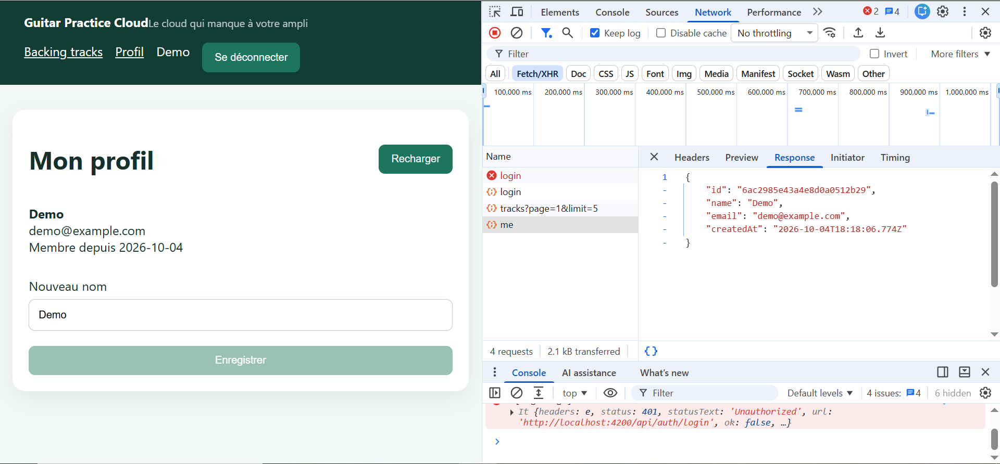
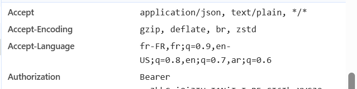
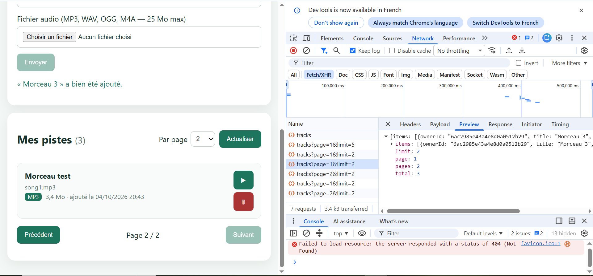
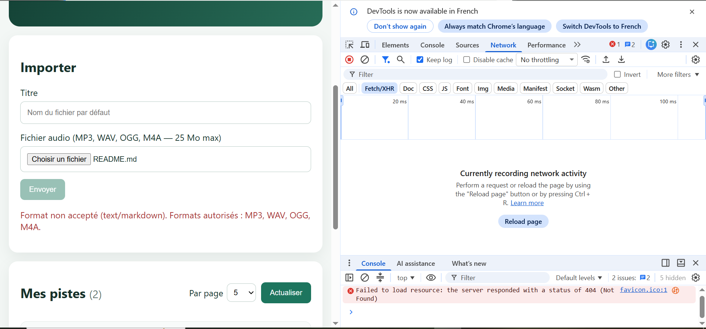
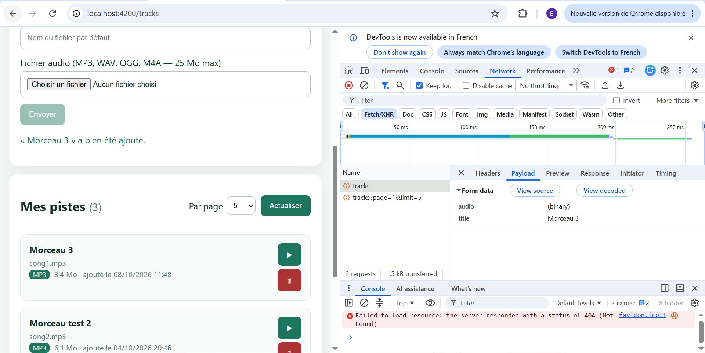
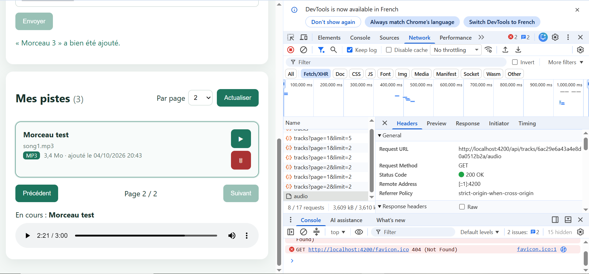
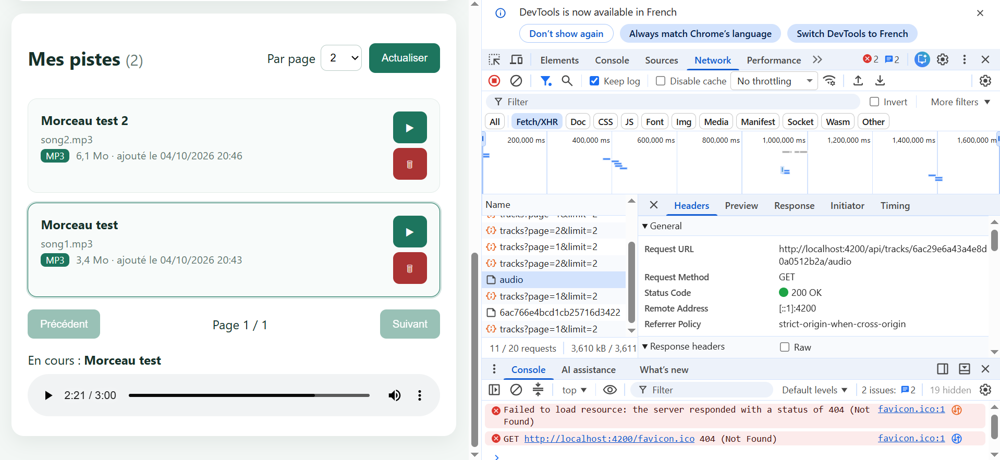

# Rapport d'usage de l'IA - TP1

Étudiante : Emili MERAHI

## Outil utilisé

- Assistant : Claude (Anthropic), utilisé comme guide pas à pas : il expliquait chaque étape et fournissait le code, que j'ai moi-même collé dans les fichiers, enregistré et testé dans le navigateur.
- Modèle : Claude Opus
- Consommation de tokens : non affichée dans l'interface utilisée.

## Préparation

- **Objectif** : configurer MongoDB Atlas, le fichier `backend/.env`, lancer le backend et le frontend.
- **Ce que j'ai fait** : réutilisation de mon cluster Atlas existant, réinitialisation du mot de passe de l'utilisateur de base, accès réseau `0.0.0.0/0`, construction de l'URI avec le nom de base `guitar-practice-cloud`.
- **Problèmes rencontrés** :
  - PowerShell bloquait `npm` (politique d'exécution des scripts) → passage au terminal Git Bash.
  - Dans `.env`, la clé `MONGODB_URI=` était écrite deux fois → corrigé.
  - La touche F12 éteint mon PC → ouverture des DevTools par clic droit → « Inspecter ».
- **Vérifications** : `GET /api/health` → `{"status":"ok"}` ; terminal backend : « Connecté à MongoDB Atlas » et « Compte de démonstration créé » ; upload et lecture de `song1.mp3` et `song2.mp3`.
- **Point de vigilance** : j'ai transmis par erreur le mot de passe de la base à l'assistant ; je dois le changer dans Atlas (Database Access → Edit Password) et mettre à jour `.env`.

## Mission 0 — Cartographie

- **Objectif** : repérer composant racine, routes, HttpClient, modèles/services/pages, intercepteur JWT.
- **Prompt principal** : « Voici le projet et le sujet du TP1. Guide-moi étape par étape pour repérer le composant racine, les routes, l'enregistrement de HttpClient, les services et l'intercepteur JWT, puis pour schématiser le flux de connexion. Je veux comprendre le rôle de chaque fichier. »
- **Plan proposé par l'agent** : lire `main.ts`, puis `routes.ts`, puis `shared/` (services, intercepteur, guard), puis écrire la cartographie et le schéma du flux de connexion.
- **Vérifications** : j'ai ouvert chaque fichier cité ; j'ai testé la redirection d'une adresse inconnue vers `/tracks` (route `**`).
- **Résultat** : voir [TP1_REPONSES.md](TP1_REPONSES.md).

## Mission 1 — Inscription, connexion et profil

- **Objectif** : formulaires réactifs validés, appels register/login, stockage du JWT, Signal `currentUser`, redirections, déconnexion, profil, gestion du 401.
- **Prompt principal** : « Aide-moi à compléter l'inscription, la connexion et le profil avec des formulaires réactifs validés comme le backend. Tous les appels HTTP doivent rester dans `AuthService`, le JWT ne doit jamais apparaître dans la console, et un 401 doit renvoyer vers `/login`. On avance un fichier à la fois et je teste avant de passer au suivant. »
- **Plan proposé par l'agent** (une étape = un fichier, testée avant de passer à la suivante) :
  1. `shared/utils/http-error-message.ts` (nouveau) : transformer une erreur HTTP en message lisible.
  2. `AuthService` : ajout de `isAuthenticated` (`computed`) et redirection vers `/login` dans `logout()`.
  3. Page connexion : validations, messages d'erreur, bouton désactivé pendant l'envoi.
  4. En-tête (`app`) : nom de l'utilisateur + bouton « Se déconnecter », menu selon l'état connecté, profil rechargé après F5.
  5. Page inscription : validations alignées sur le backend (nom ≥ 2, email, mot de passe ≥ 8).
  6. Page profil : chargement automatique de `/api/users/me`, modification du nom, message de succès.
  7. `authInterceptor` : en cas de 401 sur une route protégée → déconnexion + `/login`.
- **Propositions écartées / points de vigilance** :
  - Le starter pré-remplissait `demo@example.com` / `Demo1234!` dans le code du formulaire : retiré (pas de mot de passe dans le code Angular).
  - Rediriger vers `/login` sur tous les 401 aurait empêché d'afficher « Identifiants incorrects » : exception pour `/api/auth/*`.
  - Les captures Network ne montrent ni le mot de passe (onglet Payload) ni le token (onglet Response du login, en-tête Authorization coupé).
- **Fichiers modifiés** (backend non modifié) :
  - `frontend-starter/src/app/shared/utils/http-error-message.ts` (nouveau)
  - `frontend-starter/src/app/shared/services/auth.service.ts`
  - `frontend-starter/src/app/shared/interceptors/auth.interceptor.ts`
  - `frontend-starter/src/app/components/app/app.ts` et `app.html`
  - `frontend-starter/src/app/components/login-page/login-page.ts` et `.html`
  - `frontend-starter/src/app/components/register-page/register-page.ts` et `.html`
  - `frontend-starter/src/app/components/profile-page/profile-page.ts` et `.html`
- **Tests réalisés** :
  - Connexion : champs vides → messages ; mauvais mot de passe → « Identifiants incorrects » (401) ; bon mot de passe → `/tracks`.
  - Déconnexion → `/login`, token supprimé du localStorage.
  - Inscription : mot de passe trop court → message ; `demo@example.com` → « Email déjà utilisé » (409) ; nouveau compte → `/profile`.
  - Profil : nom chargé automatiquement ; modification → « Nom mis à jour. » et nom changé dans l'en-tête.
  - Token remplacé par `abc` dans le localStorage + F5 → retour automatique sur `/login`.
- **Preuves** :
  - 
  - 
  - 
  - 
- **Ce que je sais maintenant expliquer sans l'agent** :
  - le trajet d'une requête de connexion : composant → service → HttpClient → intercepteur → proxy → Express → MongoDB ;
  - le rôle de l'intercepteur (ajout du `Bearer` et gestion du 401) et du guard (protection des routes) ;
  - pourquoi `tap()` dans le service : mémoriser token et utilisateur sans bloquer la réponse ;
  - la différence entre Signal (réactif, en mémoire) et localStorage (persistant, non réactif) ;
  - pourquoi le composant ne fait jamais d'appel HTTP directement.

---

# Rapport d'usage de l'IA - TP2

## Préparation

- **Objectif** : relancer backend et frontend.
- **Problème rencontré** : PowerShell bloquait encore `npm` → réglé définitivement avec `Set-ExecutionPolicy -Scope CurrentUser RemoteSigned`.
- **Vérification** : « Connecté à MongoDB Atlas », connexion avec le compte démo, page Backing tracks affichée.

## Mission 2 — Bibliothèque paginée

- **Objectif** : pagination côté serveur avec `GET /api/tracks?page=…&limit=…`, état en Signals, `@for` / `@empty` / `@if`, boutons Précédent / Suivant désactivés aux bornes.
- **Prompt principal** : « Voici le sujet du TP2 et `API_CONTRACT.md`. Aide-moi à mettre en place une pagination côté serveur : une nouvelle requête `GET /api/tracks?page=…&limit=…` à chaque changement de page, un état géré avec des Signals et des boutons désactivés aux bornes. Explique-moi chaque fichier avant que je le modifie, et sans toucher au backend. »
- **Contexte fourni à l'agent** : le projet complet (archive du dépôt), `SUJET_ETUDIANT_TP2.md`, `API_CONTRACT.md` et les consignes `AGENTS.md` / `best-practices.md`.
- **Plan proposé par l'agent** : vérifier que `TrackService.list(page, limit)` transmet bien `page` et `limit`, puis ajouter dans le composant les Signals `tracks`, `page`, `pages`, `total`, `limit`, `loading`, `error`, une nouvelle requête à chaque changement de page et un choix « par page » (2 / 5 / 10) pour tester la pagination avec peu de pistes.
- **Vérifications** : avec « 2 par page » et 3 pistes → « Page 1 / 2 » puis « Page 2 / 2 » ; dans Network, `tracks?page=1&limit=2` puis `tracks?page=2&limit=2` ; Précédent grisé en page 1, Suivant grisé en dernière page.
- **Proposition écartée** : récupérer toutes les pistes puis les découper dans Angular (interdit par le sujet). Les options avancées (Angular Material Paginator, plugin `aggregate-paginate-v2`) n'ont pas été réalisées.
- **Fichiers modifiés** : `shared/services/track.service.ts`, `components/tracks-page/tracks-page.ts` et `.html`.
- **Preuve** : 

## Mission 3 — Upload et lecture audio

- **Objectif** : analyser le flux existant, valider le fichier côté front, gérer l'état pendant l'envoi, cards accessibles, lecteur avec morceau en cours, erreur audio et révocation de l'ObjectURL.
- **Prompt principal** : « Explique-moi le flux d'upload (`FormData`) et de lecture (`Blob` → `ObjectURL`), puis aide-moi à ajouter une validation du fichier identique à celle du backend, un état pendant l'envoi, des cards accessibles et un lecteur qui gère les erreurs et libère la mémoire. Indique-moi aussi quoi capturer dans Network sans montrer le token. »
- **Plan proposé par l'agent** :
  1. `track.service.ts` : commentaires sur `FormData` (`audio`, `title`) et `responseType: 'blob'`, ajout de `remove()` (bonus suppression).
  2. `tracks-page.ts` : validation (mêmes types MIME et même limite de 25 Mo que le backend), Signals `uploading` / `uploadError` / `uploadSuccess`, formulaire vidé et retour page 1 après succès, `playing`, `audioError`, révocation de l'URL dans `DestroyRef.onDestroy`, formatage de la taille, du format et de la date.
  3. `tracks-page.html` : cards, messages, lecteur avec `(error)`, boutons avec `aria-label`.
  4. `tracks-page.css` : grille responsive de cards, focus visible au clavier.
- **Propositions écartées** : mettre directement l'URL de l'API dans `<audio src>` (pas de header `Authorization` → 401) ; réimplémenter l'upload ou modifier le backend (interdit par le sujet : on complète seulement le frontend).
- **Point d'attention** : la taille était affichée « 3605337 Ko » alors que le backend renvoie des **octets** → corrigé avec `formatSize()` (« 3,4 Mo »).
- **Fichiers modifiés** (backend non modifié, contrat HTTP inchangé) :
  - `frontend-starter/src/app/shared/services/track.service.ts`
  - `frontend-starter/src/app/components/tracks-page/tracks-page.ts`
  - `frontend-starter/src/app/components/tracks-page/tracks-page.html`
  - `frontend-starter/src/app/components/tracks-page/tracks-page.css`
- **Tests réalisés** :
  - Fichier `README.md` choisi → « Format non accepté (text/markdown) », bouton Envoyer grisé, aucune requête dans Network.
  - Upload de `song1.mp3` avec le titre « Morceau 3 » → « Envoi en cours… », message de succès, formulaire vidé, Mes pistes (3), `POST /api/tracks` en multipart (`audio` + `title`) → 201.
  - Lecture → `GET /api/tracks/:id/audio` → 200, lecteur, « En cours : … », card mise en évidence.
  - Suppression de « Morceau 3 » avec confirmation → requête DELETE, Mes pistes (2), liste rechargée.
- **Preuves** :
  - 
  - 
  - 
  - 
  - 
- **Ce que je sais maintenant expliquer sans l'agent** :
  - pourquoi la pagination doit être faite par le serveur (une requête par page, pas de découpe locale) ;
  - le rôle du `FormData` et pourquoi les champs doivent s'appeler `audio` et `title` ;
  - pourquoi `<audio src="/api/…">` ne fonctionne pas avec un JWT, et le trajet `Blob` → `ObjectURL` → lecteur ;
  - pourquoi il faut révoquer l'ObjectURL (fuite mémoire) ;
  - pourquoi la validation front ne remplace pas la validation back ;
  - la différence entre téléchargement complet d'un Blob, buffering du navigateur et streaming serveur.

---

# Rapport d'usage de l'IA - TP3

## Préparation

- **Objectif** : installer ce qui manquait pour les missions du TP3.
- **Ce que j'ai fait** : installation d'Angular Material (`@angular/material`, `@angular/cdk`) pour le SnackBar demandé, et de `jsdom` pour les tests ; ajout du thème Material dans `styles.css`.
- **Problème rencontré** : `ng test` refusait de démarrer (configuration « development » introuvable) → ajout de l'option `buildTarget` dans la cible `test` de `angular.json`.

## Mission 5 — Suppression d'une piste

- **Objectif** : bouton « Supprimer » dans chaque card, confirmation, anti double clic, message SnackBar, rechargement de la liste, gestion du 404.
- **Prompt principal** : « Voici le sujet du TP3. Aide-moi à ajouter la suppression d'une piste en passant par `TrackService`, avec une confirmation, un blocage du double clic, un message SnackBar et la gestion du cas 404. Explique chaque étape pour que je puisse la refaire. »
- **Plan proposé par l'agent** : `TrackService.remove()` → `DELETE /api/tracks/:id` ; dans le composant, `confirm()`, Signal `deletingId`, `MatSnackBar`, `load()` après suppression, cas 404 traité à part.
- **Erreur corrigée** : le 404 était d'abord écrit avec `console.error` ; changé en `console.warn`, car c'est un cas prévu et pas un bug.
- **Fichiers modifiés** : `track.service.ts`, `tracks-page.ts`, `tracks-page.html`, `tracks-page.css`, `styles.css`, `package.json`. Backend non modifié.
- **Vérifications** : suppression testée dans le navigateur (SnackBar visible) ; Network : `DELETE` → `204 No Content`, pas de JWT visible.
- **Preuves** :
  - 
  - 

## Mission 6 — Progression de l'upload

- **Objectif** : afficher un pourcentage et gérer 4 états (aucun envoi, en cours, réussi, échec), contrôles désactivés pendant l'envoi.
- **Prompt principal** : « Comment afficher la progression d'un upload avec HttpClient ? Je veux distinguer les états aucun envoi / en cours / réussi / échec et bloquer le formulaire pendant l'envoi. »
- **Plan proposé par l'agent** : `reportProgress: true` + `observe: 'events'` dans le service ; Signals `uploadState` et `progress` ; calcul `100 * loaded / total` ; `<progress>` dans le template.
- **Problème rencontré** : avec la limitation « 3G » de Chrome, la barre restait à 0 %. La capture montre donc l'état « en cours », et le pourcentage est prouvé par un test automatisé.
- **Fichiers modifiés** : `track.service.ts`, `tracks-page.ts`, `tracks-page.html`, `tracks-page.css`.
- **Preuves** :
  - 
  - 

## Mission 7 — Tests automatisés

- **Objectif** : au moins 3 tests frontend, sans backend ni MongoDB.
- **Prompt principal** : « Aide-moi à écrire au moins trois tests frontend qui vérifient les URL, les méthodes et les headers, avec des réponses HTTP simulées, sans dépendre du backend ni de MongoDB. »
- **Plan proposé par l'agent** : 5 fichiers de tests avec `HttpTestingController` (service des pistes, connexion, intercepteur, guard, composant).
- **Fichiers créés** : `track.service.spec.ts`, `auth.service.spec.ts`, `auth.interceptor.spec.ts`, `auth.guard.spec.ts`, `tracks-page.spec.ts`.
- **Vérifications** : `npm test` frontend → 5 fichiers, 12 tests réussis ; `npm test` backend → 2 tests réussis ; `npm run build` sans erreur.
- **Preuves** (tableau des résultats attendus / observés dans [TP3_REPONSES.md](TP3_REPONSES.md)) :
  - 
  - 
- **Ce que je sais maintenant expliquer sans l'agent** :
  - pourquoi la suppression passe par `TrackService` et pas directement par `HttpClient` dans le composant ;
  - comment le backend protège la suppression (JWT + `ownerId`, réponse 404 sinon) ;
  - comment Angular calcule le pourcentage d'upload (`loaded / total`) ;
  - pourquoi les tests HTTP n'ont pas besoin de MongoDB (`HttpTestingController` + `flush()`) ;
  - ce que vérifient les tests d'intercepteur et de guard ;
  - la différence entre un test unitaire et un test d'intégration.