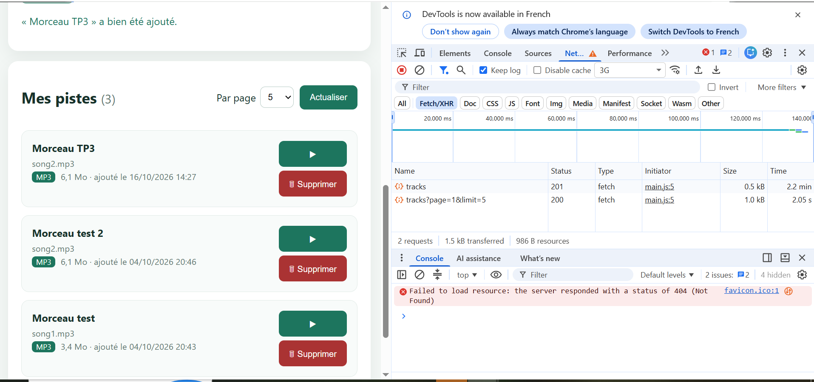
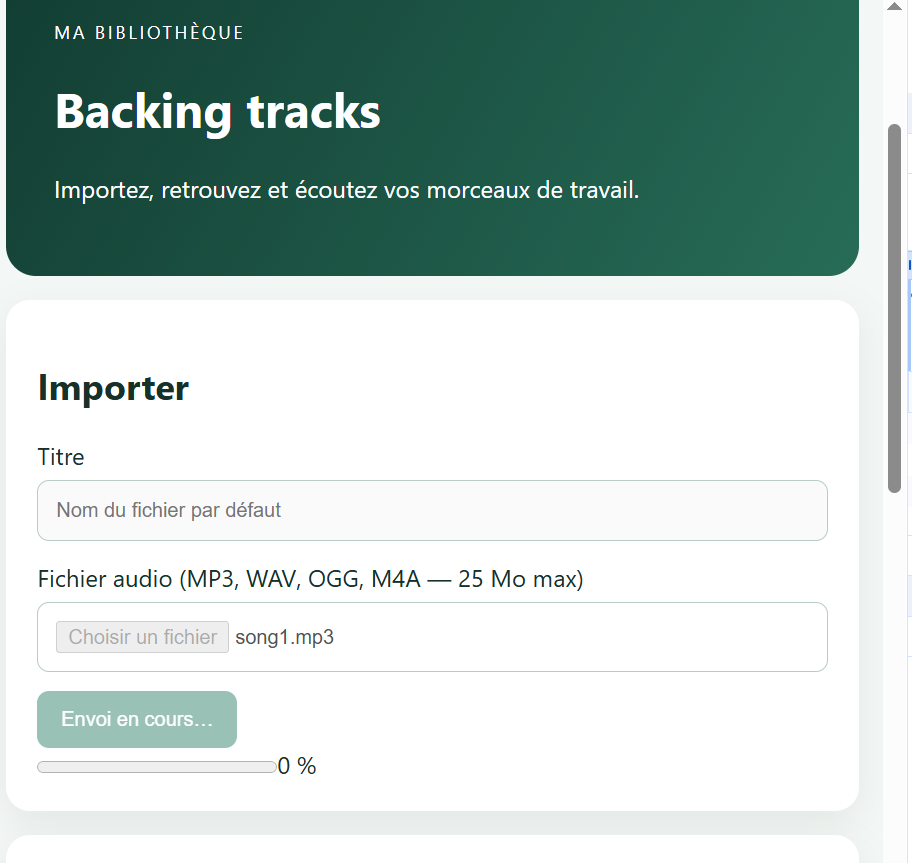
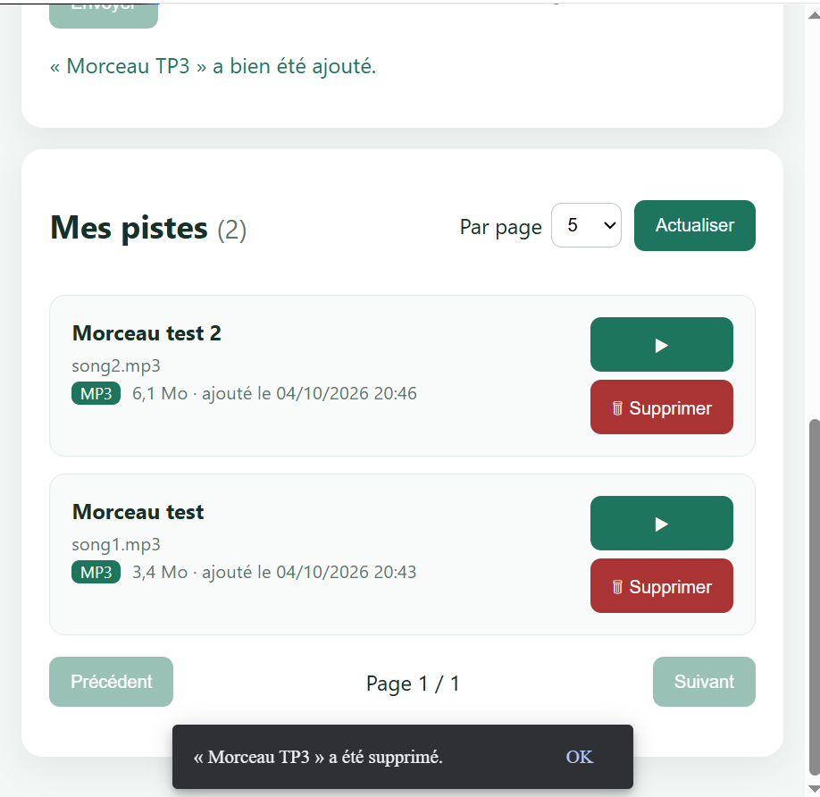
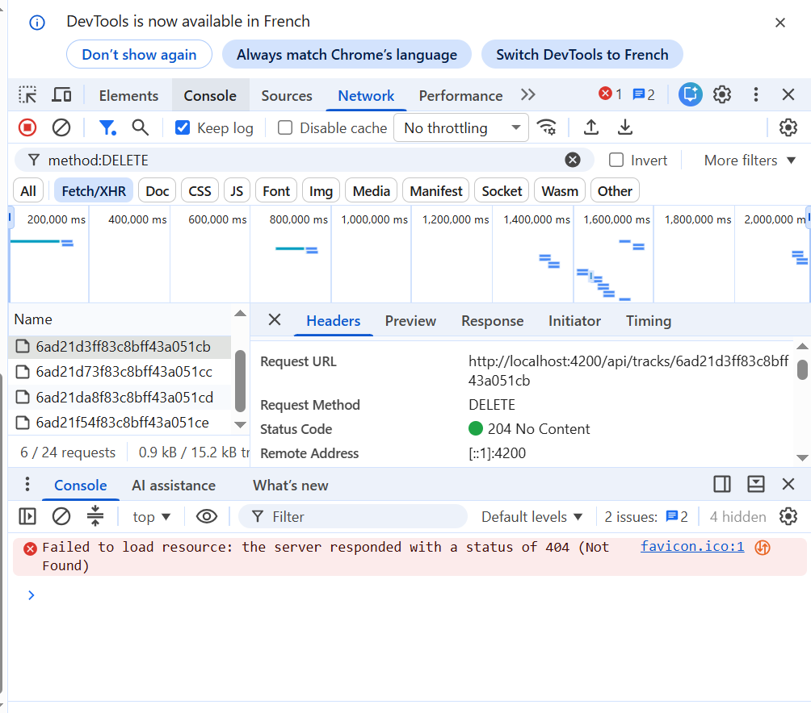
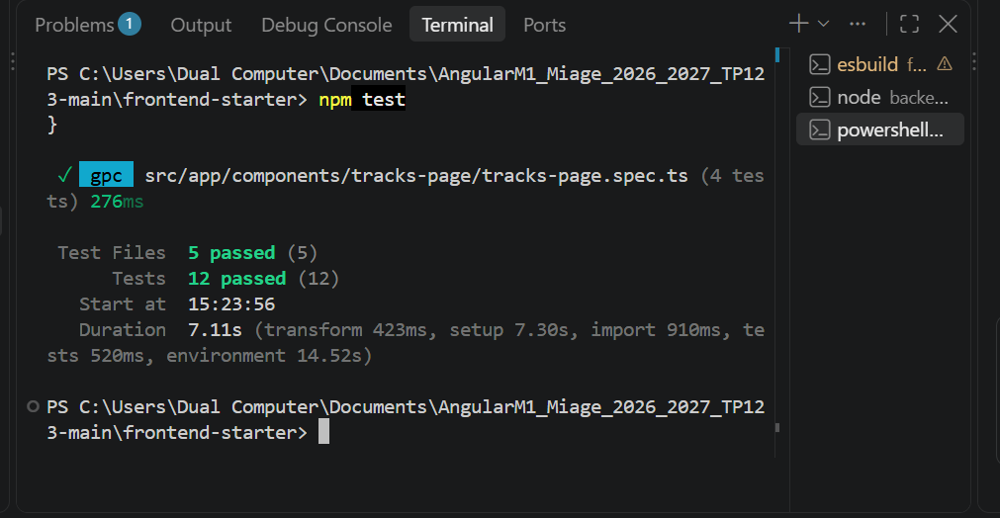
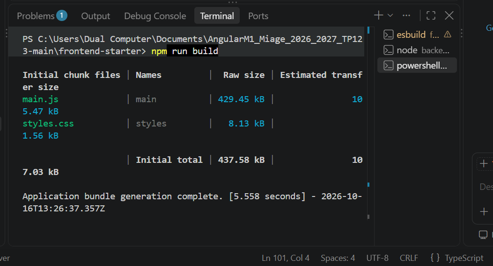

# TP3 — Réponses et livrables

Étudiante : Emili MERAHI 

Backend : **non modifié**.

---

## Mission 5 — Suppression d'une piste

**Flux :** card de piste → `TracksPageComponent.remove()` → `TrackService.remove(id)` → `HttpClient` → `DELETE /api/tracks/:id` (+ JWT ajouté par `authInterceptor`).

Ce qui a été fait (`tracks-page.ts` / `.html`, `track.service.ts`) :

- un bouton **🗑 Supprimer** dans chaque card ;
- une confirmation avec `confirm()` avant l'appel ;
- un Signal `deletingId` : le bouton de la piste est désactivé pendant la requête, ce qui empêche le double clic ;
- un message affiché dans un **SnackBar Angular Material** (`MatSnackBar`), en cas de succès comme d'erreur ;
- un rechargement de la liste depuis le serveur après la suppression (`load()`), avec retour à la page précédente si la page devient vide ;
- un **404** (piste déjà supprimée dans un autre onglet, ou piste d'un autre utilisateur) → SnackBar « Cette piste n'existe plus ou ne vous appartient pas » + rechargement de la liste. C'est un cas prévu, donc `console.warn` et non `console.error`.

**Pourquoi passer par un service ?** Le composant gère seulement l'affichage. Les appels HTTP sont regroupés dans `TrackService`. Le code est réutilisable et facile à tester (on teste l'URL et la méthode sans afficher de composant), et les URL ne sont pas dispersées dans les pages.

**Pourquoi le guard et l'interface ne suffisent pas ?** Le guard et le bouton tournent dans le navigateur, et l'utilisateur peut les contourner (DevTools, Postman, `curl`). La vraie protection est dans le **backend** : le middleware `auth` vérifie le JWT (sinon **401**), puis la suppression cherche la piste avec `_id` **et** `ownerId = utilisateur du JWT`. Si la piste n'appartient pas à l'utilisateur, le backend répond **404** et ne supprime rien.

## Mission 6 — Progression de l'upload

`TrackService.upload()` envoie un `FormData` (`audio`, `title`) avec `{ reportProgress: true, observe: 'events' }`.

Les 4 états sont gérés avec un Signal `uploadState` : `'idle' | 'uploading' | 'success' | 'error'`.

- Pendant l'envoi (`uploading`), le bouton, le champ fichier et le titre sont désactivés, et une seconde soumission est ignorée.
- Une `<progress>` affiche le pourcentage.
- Le mot de passe et le JWT ne sont jamais affichés ni écrits dans la console.

**Calcul du pourcentage :** pour chaque événement `HttpEventType.UploadProgress`, `pourcentage = Math.round(100 * event.loaded / event.total)`. `loaded` correspond aux octets déjà envoyés et `total` à la taille totale.

**Différence avec une requête « classique » :** un `get()` normal émet **une seule valeur**, la réponse finale. Avec `observe: 'events'`, l'Observable émet **plusieurs événements** : `Sent`, puis plusieurs `UploadProgress`, puis `Response`. Il faut donc tester `event.type` dans `next` pour savoir quoi faire : mettre à jour la barre ou terminer l'upload.

> Remarque : en local, l'envoi est presque instantané. Avec la limitation « 3G » de Chrome, la barre restait à 0 % pendant l'envoi : la simulation de Chrome ne reflète pas bien la progression d'un upload. La capture montre donc l'état « en cours ». Le calcul du pourcentage est prouvé par un test automatisé (40/100 → 40 %).

## Mission 7 — Tests automatisés

Les tests utilisent Vitest via `ng test` (environnement jsdom). Les réponses HTTP sont **simulées** avec `HttpTestingController` (`provideHttpClientTesting`).

**Pourquoi pas besoin de MongoDB ?** Aucune requête ne part réellement : `HttpTestingController` intercepte la requête. Le test vérifie ensuite l'URL, la méthode, les paramètres et les headers, puis répond lui-même avec `flush()` (succès ou erreur). Les tests sont donc rapides et reproductibles, même sans backend ni base.

**Test d'intercepteur / de guard :**

- Le test d'intercepteur vérifie que le header `Authorization: Bearer <token>` est ajouté quand un token existe, et absent sinon.
- Le test de guard vérifie qu'un utilisateur sans token est redirigé vers `/login` (`UrlTree`), et qu'un utilisateur avec token passe (`true`).

**Test unitaire vs test d'intégration :**

- Un test **unitaire** teste un élément isolé (un service, un guard) avec des dépendances simulées.
- Un test **d'intégration** vérifie que plusieurs parties marchent ensemble pour de vrai (ex. backend + MongoDB, ou front + API réelle).

Nos tests frontend sont unitaires. Les tests backend fournis (`node --test`) testent l'API Express sans MongoDB.

### Rapport des tests (résultat attendu / observé)

| Fichier | Test | Attendu | Observé |
|---|---|---|---|
| `track.service.spec.ts` | `list(2, 5)` | `GET /api/tracks?page=2&limit=5`, total = 7 | ✅ |
| `track.service.spec.ts` | `remove('abc123')` | `DELETE /api/tracks/abc123`, 204 → terminé | ✅ |
| `track.service.spec.ts` | `upload()` | `POST` avec FormData `audio` + `title`, événements `UploadProgress` puis `Response` | ✅ |
| `auth.service.spec.ts` | `login()` | `POST /api/auth/login` avec `{email, password}`, token et utilisateur mémorisés | ✅ |
| `auth.interceptor.spec.ts` | avec token | header `Authorization: Bearer faux-jwt` | ✅ |
| `auth.interceptor.spec.ts` | sans token | pas de header `Authorization` | ✅ |
| `auth.guard.spec.ts` | sans token | redirection vers `/login` | ✅ |
| `auth.guard.spec.ts` | avec token | accès autorisé (`true`) | ✅ |
| `tracks-page.spec.ts` | suppression | `DELETE /api/tracks/t1`, bouton bloqué pendant la requête, puis nouveau `GET` de la liste | ✅ |
| `tracks-page.spec.ts` | suppression 404 | pas de plantage, liste rechargée | ✅ |
| `tracks-page.spec.ts` | upload | état `uploading`, 40/100 → 40 %, 2ᵉ envoi ignoré, erreur 400 → état `error` + message | ✅ |
| `tracks-page.spec.ts` | liste en erreur 500 | `loading = false`, message « Erreur serveur » | ✅ |

**Résultat :** `npm test` (frontend) → **5 fichiers, 12 tests réussis**. `npm test` (backend) → **2 tests réussis**.

Les messages `stderr` (400, 500, 404) visibles pendant les tests sont normaux : ce sont les erreurs simulées exprès.

## Vérifications finales et preuves

- `npm run build` : réussi, sans erreur.
- Network : `DELETE /api/tracks/:id` → **204 No Content** après confirmation, et `POST /api/tracks` pour l'upload.
- Console : pas d'erreur inattendue (seul `favicon.ico 404`, sans lien avec l'application), aucun JWT ni mot de passe affiché.

Installations ajoutées au frontend : `@angular/material` + `@angular/cdk` (pour le SnackBar demandé) et `jsdom` (pour que les tests Angular tournent sans navigateur).

**Captures :**

